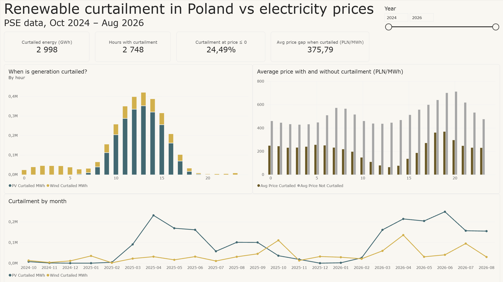

# Renewable energy curtailment in Poland vs electricity prices

When the grid cannot absorb all the electricity produced by solar and wind farms, the Polish transmission system operator (PSE) orders them to reduce output. This project collects public PSE data on those curtailments, sets them against market prices and weather, and analyses the patterns in Power BI.

**Question:** when is renewable generation curtailed, and how does curtailment relate to electricity prices?



## Key findings (Oct 2024 – Aug 2026)

- **About 3.0 TWh of renewable generation was curtailed**, spread over roughly 2,750 hours.
- **Curtailment is mostly a solar, midday problem.** It concentrates between 11:00 and 15:00 and peaks around 13:00. At night only wind is curtailed, and on a small scale.
- **It is strongly seasonal.** Solar curtailment rises from March and is highest between April and June; spring and summer 2026 were higher than 2025, with the maximum in June 2026.
- **Curtailment coincides with low prices.** On average the market price was about **376 PLN/MWh lower** in curtailed quarter-hours than in other ones. Around 13:00 the average price during curtailment fell to a few dozen PLN/MWh, compared with about 440 PLN/MWh without curtailment.
- **In 24.5% of curtailed quarter-hours the price was zero or negative**, meaning producers would have had to pay to deliver electricity to the grid.

These are co-occurrences, not causal effects: curtailment and low prices share a common cause, a surplus of solar generation at times of low demand.

## Data sources

| Dataset         | Source                                      | Resolution | Content                                                            |
| --------------- | ------------------------------------------- | ---------- | ------------------------------------------------------------------ |
| `poze-redoze` | [PSE API](https://api.raporty.pse.pl)        | 15 min     | Curtailment of solar (`pv_*`) and wind (`wi_*`) generation, MW |
| `rce-pln`     | [PSE API](https://api.raporty.pse.pl)        | 15 min     | Market price of electricity (RCE), PLN/MWh                         |
| Weather         | [Open-Meteo archive](https://open-meteo.com) | 1 h        | Wind speed at 10 m, shortwave solar radiation                      |

## Pipeline

```
src/fetch_pse.py ─────┐
                      ├─► data/raw/*.parquet ─► src/transform.py ─► data/processed/*.parquet ─► Power BI
src/fetch_weather.py ─┘
```

| Step                 | What it does                                                                                    |
| -------------------- | ----------------------------------------------------------------------------------------------- |
| `fetch_pse.py`     | Downloads curtailment and price data from the PSE API                                          |
| `fetch_weather.py` | Downloads hourly weather from Open-Meteo                                                        |
| `transform.py`     | Parses timestamps, adds local time, converts MW to MWh, moves weather onto the 15-minute grid |
| Power BI             | Star schema with date and time dimensions, DAX measures, one report page                       |

## How to run

```bash
python -m venv .venv
source .venv/bin/activate          # Windows (Git Bash): source .venv/Scripts/activate
pip install -r requirements.txt

cd src
python fetch_pse.py
python fetch_weather.py
python transform.py
```

Then open `powerbi/dashboard.pbip` in Power BI Desktop, go to **Transform data → Manage parameters** and set `DataFolder` to the full path of `data/processed/` on your machine, ending with a backslash.

## Design decisions

- **Parquet instead of CSV** keeps data types and is much smaller.
- **Time is stored in UTC and in local time.** UTC avoids ambiguity around daylight saving changes; local time is needed to analyse curtailment by hour of day.
- **Local time is stored without a time zone**, because Power BI reads time-zone-aware Parquet columns as UTC and would shift every hour.
- **Star schema in Power BI.** The three datasets are not joined to each other but share a date dimension and a 15-minute time dimension.
- **Measures in a dedicated table**, with units in their names.

## Limitations

- Only **balancing curtailment** (`*_red_balance`) is analysed; curtailment for network reasons (`*_red_network`) is not included.
- Weather comes from **a single point** (the geographic centre of Poland), while curtailment is national. Regional weather would describe conditions much better.
- Missing curtailment values are treated as **no curtailment**.
- Timestamps mark the **end** of each 15-minute period, so hour-of-day and daily aggregations are shifted by that amount.
- Price data starts in July 2024 and curtailment data in October 2024; quarters without curtailment data are excluded from the price comparison.
